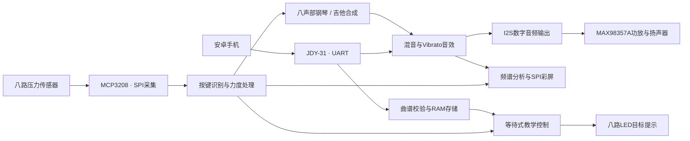

# 基于 FPGA 的八键压力感应多音色电子琴

**压力演奏 · 钢琴 / 吉他双音色 · 实时频谱 · 蓝牙曲谱教学 · Vibrato 音效**

本项目基于 **Tang Mega 60K FPGA**，将八路压力传感器转化为可演奏的电子琴键，在 FPGA 内完成音符触发、力度处理、多声部合成、音效处理与数字音频输出。

演奏者可以使用压力键弹奏钢琴或吉他音色，在彩屏上观察按键状态与声音频谱，也可以通过安卓手机蓝牙下载曲谱，由 LED 提示目标键进行跟练。项目将演奏、声音合成与可视化反馈整合在同一套硬件中，音频与教学处理链路均由 Verilog RTL 实现。

## 功能概览

| 功能 | 实现方式与交互 |
| --- | --- |
| 八键压力演奏 | MCP3208 采集八路模拟压力信号，完成按下 / 松开识别与力度映射 |
| 八声部合成 | 八个键可同时触发，支持多键演奏与和弦 |
| 钢琴音色 | 采用 20 分音合成模型，结合 ADSR 包络形成起音和衰减变化 |
| 吉他音色 | 采用分数延时弦模型，模拟拨弦后的自然衰减 |
| 音色与音区切换 | KEY1 切换钢琴 / 吉他，KEY2 循环原音区、升八度、降八度 |
| 实时显示 | SPI 彩屏显示音色页面、实际按键高亮与来自输出 PCM 的实时频谱 |
| 蓝牙曲谱下载 | JDY-31 串口透传接收文本曲谱，支持数量检查、CRC 校验及最多 256 条事件 |
| LED 跟练教学 | 按下载曲谱提示目标键，普通音和和弦按对即推进，连续同音需松开重按 |
| Vibrato 音高颤动 | 钢琴和吉他共用后级音效，蓝牙控制开关并平滑过渡 |

## 系统架构



手机负责发送曲谱和控制命令；声音合成、教学判断、频谱运算与显示驱动在 FPGA 内执行。教学只观察真实按键输入，不代替演奏者自动发声。

## 设计特点

### 从压力输入到演奏力度

八路压力信号通过外部 ADC 采集，经过阈值、连续帧确认和力度处理后生成完整的八键控制帧。音符触发与演奏力度分别进入合成链路，支持多键同时演奏。

### 两种合成思路

钢琴音色采用分音叠加，吉他音色采用弦模型；两者共用八声部调度、混音与 I2S 输出链路。按键切换的音色与音区设置会在适合的空闲时刻应用，避免直接打断正在发声的声部。

### 基于真实音频的可视化

频谱数据来自实际输出的 PCM，使用加窗的 256 点串行 DFT 进行分析。屏幕按键高亮来自真实压力控制帧，频谱反映合成与音效处理后的声音，而不是预设的音符动画。

### 可下载的曲谱教学

曲谱经蓝牙接收、校验后存入 FPGA RAM。发送 `TEACH` 后，LED 显示当前目标键组合：

- 普通音和和弦：检测到正确的新按压后推进，不要求固定保持 0.5 秒或 1 秒。
- 连续同音：长按只计一次，需松开对应键后重新按压。
- 错键或多余按键：不通过当前步骤，等待修正。
- 休止：全部松开并持续达到曲谱指定时长后推进。
- 输入数据过期：暂停判断，恢复后需要新的全松帧准备。

该模式面向认键与跟练，当前不进行严格的节奏或力度评分。

### 共用的 Vibrato 音效

Vibrato 作用于混音后的 PCM，通过周期变化的分数延时产生音高颤动。默认调制频率约 **5 Hz**、音高摆幅约 **±1%**，开启和关闭采用约 **5.24 ms** 的平滑过渡。以上为设计参数及仿真分析结果，详细实现见 [Vibrato 设计说明](docs/VIBRATO_DESIGN.md)。

## 硬件组成

| 模块 | 型号 / 说明 |
| --- | --- |
| FPGA 开发板 | Tang Mega 60K，GW5AT-LV60PG484AC1/I0，Device Version B |
| 系统时钟 | 50 MHz |
| 演奏输入 | 八个模拟压力传感器及对应前端电路 |
| ADC | MCP3208，八通道、12 位，SPI 接口 |
| 音频输出 | MAX98357A I2S 功放及扬声器 |
| 显示 | SPI TFT 彩屏 |
| 无线通信 | JDY-31 蓝牙串口模块，配合安卓串口 App |
| 教学提示 | 八个高电平有效 LED，每路独立限流 |

原音区下，K1～K8 对应 **C4、D4、E4、F4、G4、A4、B4、C5**。切换音区后，LED 仍对应这八个实体键的位置。

完整引脚与 IO 电平见 [引脚说明](docs/PINS.md)，实际约束位于 [constraints](constraints/)。连接模块时应核对板卡丝印、供电和公共地。

## 快速开始

### 1. 构建与下载程序

1. 安装支持 GW5AT-60B 的 Gowin FPGA Designer 与 Programmer。
2. 打开根目录的 [eight_key_instrument_display.gprj](eight_key_instrument_display.gprj)。
3. 顶层选择 `eight_key_instrument_display_top`，器件选择 `GW5AT-LV60PG484AC1/I0`、B 版。
4. 保持 CPU-as-GPIO 开启、`Route_Maxfan=60`、Timing Driven 开启。
5. 运行综合与布局布线，核对新生成的资源、时序和引脚报告。
6. 使用 Programmer 下载 `impl/pnr/eight_key_instrument_display.fs`。

在已配置 Gowin 命令行环境时，也可以从工程根目录运行：

```powershell
gw_sh.exe build.tcl
```

调试时可下载到 SRAM；需要断电后自动加载程序时，应写入板载外部 Flash。**程序固化不等于曲谱保存：当前蓝牙下载曲谱仍在 RAM 中，复位或断电后需重新发送。**

### 2. 自由演奏

上电后可直接使用八个压力键演奏。KEY1 切换音色，KEY2 切换音区；切换时先松开所有键，等待尾音结束。彩屏同步显示当前音色、实际按键状态与频谱。

### 3. 蓝牙下载《小星星》并跟练

1. 手机连接 JDY-31，FPGA 侧 UART 配置为 **9600、8N1**。
2. 串口 App 使用文本发送，每条命令带 LF 换行；CRLF 也可。
3. 发送 `PING`，确认收到 `PONG`。
4. 将 [《小星星》下载文件](songs/02_twinkle_upload_only.txt) 的全部文本按顺序发送，确认 `BEGIN`、各条 `NOTE` 和 `END` 均返回成功。
5. 全部松开压力键，发送 `TEACH`，收到 `OK TEACH` 后根据 LED 提示演奏。
6. 完成后收到 `DONE`；再次发送 `TEACH` 可从头开始，发送 `STOP` 可退出。

也可以使用末尾已带 `TEACH` 的 [下载并开始教学文件](songs/02_twinkle_upload_and_teach.txt)。[songs](songs/) 中另有八音阶、和弦、休止及连续同音样例。

### 4. 控制音高颤动

| 命令 | 回复 | 作用 |
| --- | --- | --- |
| `VIBON` | `OK VIBON` | 开启 Vibrato |
| `VIBOFF` | `OK VIBOFF` | 关闭 Vibrato |
| `VIBSTAT` | `VIBRATO ON` / `VIBRATO OFF` | 查询请求的开关状态 |

复位默认关闭。音效开关独立于教学与曲谱下载；`STOP` 不关闭音效，也不禁止真实压力键发声。状态查询反映开关设置，不代表平滑过渡已恰好完成。

## 曲谱协议与功能边界

曲谱使用 ASCII 文本，命令大写、英文逗号，以换行结束：

```text
BEGIN,N
NOTE,MM,D,H,V
...
END,CCCC
TEACH
```

| 字段 / 命令 | 含义 |
| --- | --- |
| `N` | 事件数量，1～256 |
| `MM` | 两位十六进制键掩码；`01` 为 K1，`80` 为 K8，多位置 1 表示和弦 |
| `D` | 总时长，单位 ms，1～60000；休止时用于计时 |
| `H` | 按住时长字段，0～D；当前有声教学不按此字段要求保持时长，H=0 按休止处理 |
| `V` | 原力度字段，0～127；V=0 按休止处理，教学发声音量由真实压力输入决定 |
| `CCCC` | 四位十六进制 CRC-16/CCITT-FALSE，按事件记录计算 |
| `STATUS` | 查询 `EMPTY`、`LOADING`、`READY` 或 `TEACH` |
| `STOP` | 停止教学或取消未完成下载，保留已提交曲谱 |

手工调试允许发送不带 CRC 的 `END`，正式使用建议保留校验。教学中重新下载前应先 `STOP`。格式、范围、条数或 CRC 不符会收到错误回复，应重新完整下载。

当前不支持 MP3 / 任意 MIDI 直接上传、曲谱自动播放、多曲目录、曲谱掉电保存或录音回传。外部曲谱需要先转换为八键支持的音符事件；`PLAY`、`LEDTEST`、`FREE` 不属于本版命令。

## 仓库结构

```text
.
├── rtl/                  # 输入、合成、音效、音频、显示、蓝牙与教学 RTL
├── constraints/          # 引脚与时序约束
├── tables/               # 音色、音效和频谱初始化表
├── songs/                # 可通过蓝牙发送的示例曲谱
├── tb/                   # Verilog / SystemVerilog 测试平台
├── scripts/              # 构建、仿真与结果核对脚本
├── docs/                 # 引脚、设计与验证说明
├── evidence/             # 对应版本的验证记录
├── download/             # 经检查后导出的码流
├── impl/                 # Gowin 本地生成的实现文件
├── build.tcl             # Gowin 构建入口
└── eight_key_instrument_display.gprj
```

## 验证与复现

仓库提供 **12 组检查通过的 RTL 仿真记录**，覆盖音效定点数值、蓝牙命令与回复解码、曲谱校验、按对即推进、256 条边界、停止与复位，以及实际顶层 ADC、I2S、LCD 接口闭环。

其中，Vibrato 独立定点参考检查了 **163840 个音频样本**；闭环测试验证处理后的 PCM 同时进入 I2S 与频谱链路。相关结果属于仿真与数值分析，不能代替实体测量。

- [测试结果汇总](evidence/test_report.json)
- [验证范围与方法](docs/VERIFICATION.md)
- [音效分析数据](evidence/vibrato_audio_metrics.json)
- [实现状态汇总](evidence/delivery_report.json)

现有 `delivery_report.json` 仍标记为 `NOT_BUILT`，尚未汇总本地实现产物的统一核验结果。发布时应以与源码一致的 Gowin 报告和上板记录为准，不能使用旧版本报告代替当前版本。

安装 Python 3 与 Icarus Verilog 后，从工程根目录运行：

```powershell
python scripts/run_tests.py
```

Icarus 路径可通过环境变量 `IVL_LIB` 与 `VVP_BIN` 指定。完成 Gowin 构建后，可运行 `python scripts/check_delivery.py` 检查实现结果并导出码流；按本机环境核对脚本中的工具与来源路径。

## 设计资料

- [Vibrato 分数延时与平滑过渡设计](docs/VIBRATO_DESIGN.md)
- [硬件引脚与 IO 电平](docs/PINS.md)
- [修改范围与模块接入说明](docs/CHANGES_AND_HANDOFF.md)
- [仿真验证说明](docs/VERIFICATION.md)
