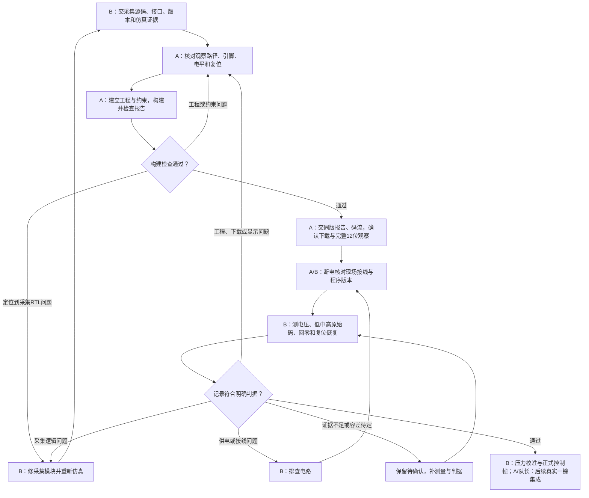

# B与A：ADC阶段总结与后续协作

日期：2026-10-13。适用对象：成员B与A共同讨论接入和实测。本文按现有源码、用户确认和具体证据总结；计划日期不代表完成日期。

## 先明确现在到哪一步

**B的ADC原始采集软件与数字仿真已完成当前阶段；真实ADC采集还没有上板验收。** 本次交付的是“B ADC原始采集层阶段包”，不是可直接下载的Gowin工程，也不是完整音乐引擎。

| 工作 | 已实现/已有结果 | 证据及边界 |
|---|---|---|
| 单次SPI读取 | CH0～7请求时锁存通道；50MHz/500kHz、Mode0、24完整时钟、CS高保护≥2µs；基本仿真通过 | [SPI验证记录](voice/adc_spi_sim/基本验证记录.md)及[manifest](voice/adc_spi_sim/sim/verified_20261012_224506/manifest.json)：37事务、32完整SPI、31有效发布，复位取消另计 |
| 八路原始扫描 | CH0～7内部缓存，CH7后一次发布96位raw_frame和一拍frame_valid；1ms周期；超时丢半帧并恢复 | [扫描记录](voice/adc_scan_sim/扫描验证记录.md)及[manifest](voice/adc_scan_sim/sim/verified_20261012_232222/manifest.json)：每完整轮408.48µs，复位与三种握手超时场景通过 |
| CH0最小测试top | 每1ms请求CH0、保存12位读数；低/高各6位共用快照，每页1秒，运行指示和复位恢复 | [最小顶层记录](voice/adc_min_top_sim/最小顶层验证记录.md)及[manifest](voice/adc_min_top_sim/sim/verified_20261012_235839/manifest.json)：四份TB、五组运行；4096码、8192边界valid；默认参数实际模拟两页共2秒 |
| B交接准备 | 四个最小工程RTL、端口/依赖/时序与接线候选、版本核对、实测方法和空白表 | [接入说明](voice/adc_min_top_sim/handoff/B_ADC工程接入说明.md)、[实测步骤](voice/adc_min_top_sim/handoff/B_ADC构建配合与实测步骤.md)、[空白表](voice/adc_min_top_sim/handoff/B_ADC实测记录模板.md) |
| 10/10非阻塞事项 | 已完成（用户确认），不能因附件不足反过来否定 | 具体阻塞例外、实测附件和工程绑定仍待确认；不能扩展为之后任务已完成 |

上述通过均是对应版本的电脑数字仿真。408.48µs、51.04µs等是内部数字链路仿真时间，不能当作真实按键到扬声器总延迟。

## 还没完成什么

| 事项 | 当前状态 | 主责/配合 |
|---|---|---|
| 无冲突的LED或Analyzer完整12位观察路径 | 待确认；逻辑8位显示不等于有可用物理8灯 | A落实，B提供信号和读数方法 |
| ADC专用GPRJ/CST/SDC | 当前工作区未完成 | A |
| 综合、布局布线、时序、码流、下载 | 未验证，缺对应ADC结果 | A |
| 实际VDD/VREF/VIN和固定低/中/高数字码、回零、板上复位恢复 | 未验证 | B测量，A配合下载和观察 |
| 校准、滞回、连续两轮稳定、16位力度映射、平滑 | 未实现/未验证 | B |
| 正式gate[7:0]/key_gain[127:0]/controls_valid | 未实现/未验证；96位原始帧不是这组接口 | B实现，与队长/A核对接入 |
| A实际接收和人员复核 | 待确认 | A/B，本次未发送消息或代签 |
| 八声部/音色/ADSR/整机音频/总延迟 | 不在本包通过范围，不据ADC仿真判断完成 | 队长/A/B按现行分工继续 |

实际底板31005与参考31004版本差异、去耦100nF/1µF资料差异及实际安装、电气记录仍需核对。配件已到货的用户确认保持，不再说“缺件未到”。

## 双方下一步要交什么

| 顺序 | 谁做 | 具体工作 | 交给对方什么/完成凭证 |
|---:|---|---|---|
| 1 | B | 交本阶段包，讲清文件、端口、候选接线、仿真范围和限制 | 本包源码、版本清单、日志/波形和接入说明；A收到/复核仍需实际记录 |
| 2 | A | 先落实观察路径与正式引脚、电平、复位；建立独立ADC工程 | GPRJ/CST/SDC；器件/顶层/实际引脚/LED极性或Analyzer配置说明 |
| 3 | A | 综合、布局布线、时序与告警审查，生成并确认下载对应码流 | 工具版本、源码/约束版本、完整报告、码流及哈希、实际下载记录；不要只交一个.fs |
| 4 | A/B | 断电核对现场供电、地、MISO输入方向和互斥外设 | 本次接线照片/标记、程序版本、完整12位观察方法 |
| 5 | B | 测VDD/VREF/VIN，CH0低/中/高与回零，重复读数和复位恢复 | 真实电压、逐个原始码、照片/波形、误差统计、异常说明；不填理想值冒充实测 |
| 6 | A/B | 对照同版工程与真实测量定位归属 | 供电/接线/采集问题归B；工程/约束/下载/显示映射问题归A；不盲目改另一方模块 |
| 7 | 相关负责人 | 修复后补对应验证；工程/源码有变更时重建并绑定新码流 | B功能改动重仿真，A重新构建检查，B用新版本重复必要实测 |
| 8 | B，A/队长配合 | 固定电压通过后接压力片，校准并生成正式控制帧，再进入真实一键联调 | B交gate/key_gain/controls_valid；队长提供核心，A负责后续总工程集成。没有相应证据前继续未验证 |

这里不是“A先写B的源码”。**采集源码由B提供；A提供的是把这些模块运行起来的工程、构建结果、码流和观察环境。**

## 一起讨论时按这张流程走

这张图描述下一步协作，不表示节点已经执行或通过。

## A收到B的测量后具体怎么做

1. 先核对测量用的源码、约束、码流是否同版，确认VIN确实改变、12位观察没有拼错页。
2. 若实际电压正确但读数异常，检查下载版本、MISO方向、实际引脚、显示位序/极性和复位；需要波形时落实测量条件。B同时核对ADC供电/地及接线。
3. 只有定位到具体原因才修改：A改自己负责的工程/约束/观察逻辑；B改自己的电路或采集RTL。A不根据一个“读数不对”就随意改SPI频率或硬件参数。
4. 修复后保持证据链：必要仿真→A重建/时序审查→同版下载→B重测。新版本不能继续借用旧版通过结论。
5. 若固定电压验收通过，A保存该可运行版本作为后续集成基线，等待B的真实压力控制帧与队长核心；不要将raw_frame直接冒充gate/key_gain接口。

## 本次会议先达成的五件事

- 确定A何时能提供最小ADC工程和完整读数观察；时间由本人实际确认，本文不替对方承诺。
- 明确LED还是Analyzer。参考8灯前四脚T18/R18/R17/P16与SPI冲突，禁止原样复制；R17正式必须输入。
- 对齐软件/构建/实物接线版本，确认共用板当前运行哪一套实验及外设互斥关系。
- 明确固定电压的记录方式和允许误差判据；判据未定时记录实际偏差，精度结论待确认。
- 约定异常反馈必须带版本、实际电压、完整原始码和证据位置；约定修复后由谁重建、谁重测。

固定电压的具体接法与记录表已在包内准备好。当前仅有万用表，不能据其读数证明500kHz边沿/2µs间隔/20ns valid或≤10ms整机延迟；相应项目缺测量条件就保持未验证。

本次是阶段归档，三套旧验证记录中的“尚未打包”等文字属于当时快照，原始日志/波形/manifest保留不改。当前交付边界以包根README及本总结为准。

本轮解压复现另发现当前Icarus在含中文路径中输出文件名乱码、编译失败，失败产物没有执行。复现须使用全英文目录（ZIP内根目录为B_ADC_stage_20261013_v1），工具外层异常仍按既有分阶段方式替代。失败日志保留，不能把路径问题或外层工具问题写成已经修复；具体成功/失败运行均见包内交付核验资料。
